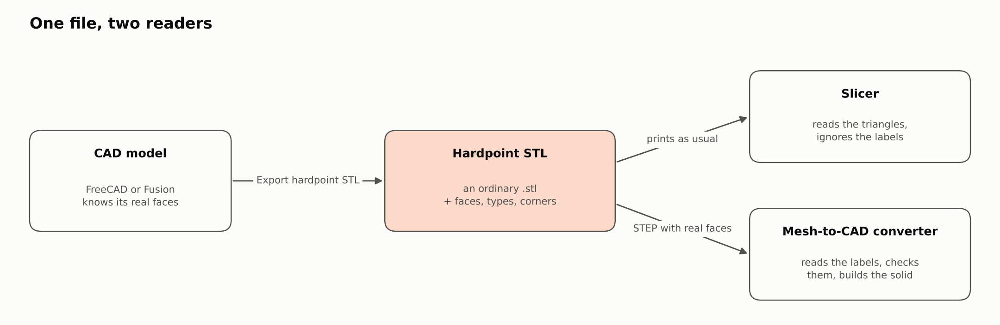
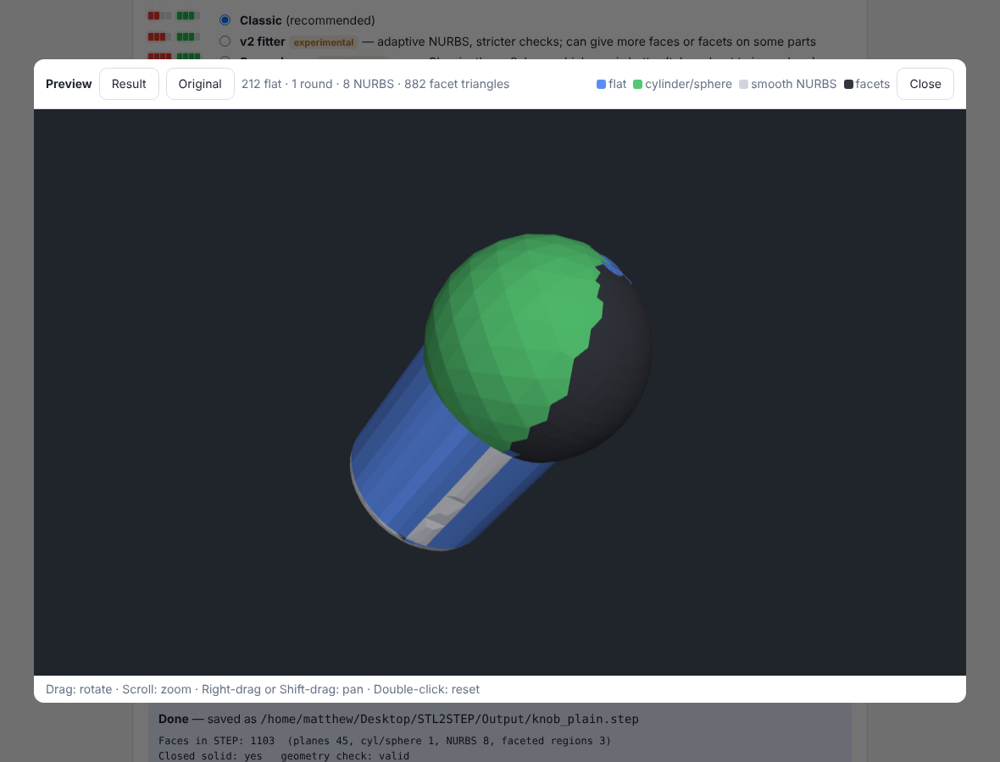

# Hardpoint STL: design notes

**WORK IN PROGRESS: MANY FEATURES MAY BE BROKEN** (hardpoint-stl 0.1.0-wip)

Notes for anyone who wants to develop the hardpoint STL format further: why it looks the way
it does, what was measured, what failed, and what is still open. Written 4 to 10 October 2026.

**Where this came from.** The format was designed and measured alongside STL2STEP, a
mesh-to-STEP converter (a separate project, not part of this repository). The converter-side
sections below ("How a converter should use the labels", "Measured results") are kept because
they are the evidence that the format helps; they describe STL2STEP's behaviour, and the
converter's code is not here. This repository contains the format, its reference reader and
writer, the two CAD exporters, the tests, the examples and these notes.

- Format specification: [HARDPOINT_STL.md](HARDPOINT_STL.md)
- Reference reader and writer: [`src/hstl.py`](src/hstl.py)
- How to use it: [README.md](README.md)

## Summary

A hardpoint STL is an ordinary binary STL whose spare bytes record which CAD face each
triangle belongs to, the kind of surface, and the CAD corners ("hardpoints"). A slicer sees a
plain STL of the same size. A mesh-to-CAD converter that knows the format rebuilds the solid
without guessing where the faces are.

*Drawn from an actual hardpoint STL (`examples/bracket_hardpoint.stl`) by `tools/make_illustrations.py`.*

- **Status:** format version 1, work in progress (hardpoint-stl 0.1.0-wip).
- **Writers:** the FreeCAD workbench and Fusion add-in (*Export hardpoint STL*), and the
  Python library `src/hstl.py`. STL2STEP could also write the format after a conversion
  (`--save-labelled`); that code is not in this repository.
- **Readers:** `src/hstl.py` (reference) and the STL2STEP converter (not included).
- **Tested:** on Linux, on simulated CAD parts built with OpenCASCADE (the kernel FreeCAD
  uses). **Not tested:** in real FreeCAD, in Fusion, or in any slicer program.

## Goals and constraints

The design had to meet six requirements, in this order.

1. **Recognised as an STL.** The file keeps the `.stl` extension and loads in any slicer
   without a plug-in.
2. **Identical to a normal STL in a slicer.** Same triangles, same file size, nothing a slicer
   acts on.
3. **Makes STL to STEP conversion easier.** It carries what a converter otherwise has to
   guess: the faces, their surface types and the corners.
4. **Writable from inside CAD programs.** FreeCAD's and Fusion's own Python have no NumPy
   guarantee, so the writer uses the standard library only.
5. **Never makes a conversion worse.** Labels are hints. The converter checks each one and
   falls back to its normal detection.
6. **Runs on low-end hardware.** The target was a 7th-generation Core i3, so the
   pure-Python writer's speed was measured.

## How STL readers behave

A binary STL has exactly two places a slicer ignores: the 80-byte header and the 2-byte
attribute field after each triangle. Anything appended after the last triangle breaks at
least two common loaders.

Binary STL layout: 80-byte header, 4-byte triangle count, then 50 bytes per triangle (12 for
the normal, 36 for three corners, 2 for the attribute field).

| Reader | Used by | Binary or text test | Triangle count | Extra bytes at the end | Attribute field | How this is known |
| --- | --- | --- | --- | --- | --- | --- |
| admesh `stlinit.cpp` | OrcaSlicer; PrusaSlicer-family slicers share this code | Binary if any of the 128 bytes after offset 84 is above 127 | Taken from the file size; the header count only logs a warning on mismatch | Rejected unless a multiple of 50, then read as phantom triangles | Read with the triangle, not used by the loader | Read [OrcaSlicer's source](https://raw.githubusercontent.com/OrcaSlicer/OrcaSlicer/main/deps_src/admesh/stlinit.cpp) |
| numpy-stl | Cura, through [Uranium's STLReader](https://raw.githubusercontent.com/Ultimaker/Uranium/main/plugins/FileHandlers/STLReader/STLReader.py) | Automatic mode | From the header | Load fails with an error | Ignored for geometry | Read Uranium's source; ran the library |
| trimesh | many Python tools, and the STL2STEP converter | Binary only if the size is exactly 84 + 50 × count, otherwise tried as text | From the header | Not binary, then fails as text (0 faces) | Kept as `face_attributes["stl"]` | Read [trimesh's source](https://raw.githubusercontent.com/mikedh/trimesh/main/trimesh/exchange/stl.py); ran the library |

Other findings that shaped the format:

- **The admesh text test misreads simple files.** A cube at whole-millimetre coordinates with
  zero normals has no byte above 127 in that window, so it is read as text and imports empty.
  This is [OrcaSlicer issue 15993](https://github.com/OrcaSlicer/OrcaSlicer/issues/15993),
  open when checked on 3 October 2026. A probe that copies the test's logic reproduced it.
- **The header must not start with `solid`.** Some software then treats the file as text
  ([Wikipedia](https://en.wikipedia.org/wiki/STL_(file_format))).
- **Two colour conventions already use the attribute field.** VisCAM and SolidView: bits 0–4
  blue, 5–9 green, 10–14 red, bit 15 = 1 means the colour is valid. Materialise Magics: a
  `COLOR=` string in the header, bits 0–4 red, 5–9 green, 10–14 blue, bit 15 = 0 means the
  triangle has its own colour.
- **trimesh drops the attribute field during clean-up.** With `process=True` the field
  survives vertex merging, but STL2STEP's sliver removal (converter side) rebuilds the mesh. On one test part
  5,572 triangles became 5,564 and the field was gone.
- **No prior art for CAD hints inside an STL was found.** Existing mesh-to-STEP tools
  ([stlToSolid](https://github.com/Crypto69/stlToSolid),
  [breptile](https://pypi.org/project/breptile/0.1.0/)) segment the mesh and fit primitives
  from the triangles alone.

## Design decisions

Every decision below follows from the reader behaviour above or from a measurement.

| Question | Chosen | Rejected | Why |
| --- | --- | --- | --- |
| Where the labels live | Header and per-triangle attribute fields | Data after the last triangle | A trailer fails in numpy-stl and trimesh and becomes phantom triangles in admesh |
| How a face is identified | A 5-bit colour; a face is the edge-connected triangles sharing it | A global face number (9 bits allowed 511 faces) | Colours label any number of faces. Test parts needed 2 to 5 colours |
| Surface parameters (plane, axis, radius) | Not stored; the reader fits them | A parameter table | No room without a trailer. Fitting is cheap once the faces are known, and the reader must verify anyway |
| The whole CAD model | Not stored | A STEP file hidden in the STL | It doesn't fit. See [Tried and dropped](#tried-and-dropped) |
| Face borders | Implied where the colour changes | Per-edge "hard edge" flags | Redundant once faces are labelled |
| CAD vertices | 3 bits per triangle, one per corner | A separate vertex list | No room. Needed where only two faces meet but a line runs into an arc |
| Header encoding | ASCII `key=value` text | A packed binary record | Readable in any tool that prints the header, and easy to extend |
| Detecting edits | CRC-32 of the triangle data in the header | No check | Stale labels on an edited mesh would mislead the converter |
| "Labelled" flag | Bit 7, and a labelled triangle is written first | A separate guard | Bit 7 of the first attribute byte also defeats the admesh text misread |
| Bit 15 | Always 0 | Free use | VisCAM-style viewers read bit 15 = 1 as "this is a colour" |
| Units | In the header | Left to the user | STL has none, and a CAD exporter knows them |
| File extension | `.stl` | A new extension | Slicers filter by extension |
| Trust | Every label is checked against tolerance | Believe the file | A wrong or stale label must not produce a wrong solid |
| Code sharing with plug-ins | A copy of `hstl.py` in each plug-in folder | Import from the app folder | The export command must work without the portable app installed |
| Cone and torus faces in the converter | Treated as freeform (NURBS) | Left to normal detection | Measured: 8 faces instead of 131 on the knob part |
| Welding per-face CAD meshes | Tolerance of 2 × 10⁻⁷ of the part diagonal | Exact match only | A CAD kernel gives the two faces along an edge points that differ in the last digits |

## Format version 1 at a glance

[HARDPOINT_STL.md](HARDPOINT_STL.md) is the full specification; this is the short form.

| Header field | Meaning |
| --- | --- |
| `HARDPOINT-STL 1` | Marker and format version |
| `u` | Units: `mm`, `in`, `cm` or `m` |
| `tol` | How far triangles may be from the true surface, in those units; 0 = unknown |
| `ang` | Meshing or sharp-edge angle in degrees; 0 = unknown |
| `crc` | CRC-32 of the 48 geometry bytes of every triangle, in file order |
| `by` | What wrote the file |

| Attribute bits | Meaning |
| --- | --- |
| 0–4 | Face colour, 0 to 31. Faces that touch along an edge never share a colour |
| 5–6 | Reserved, 0 |
| 7 | 1 = this triangle is labelled |
| 8–10 | Surface type: 0 unknown, 1 plane, 2 cylinder, 3 sphere, 4 cone, 5 torus, 6 freeform, 7 keep as facets |
| 11–13 | Hardpoint flags for corner 1, corner 2 and corner 3 of the triangle |
| 14 | Reserved, 0 |
| 15 | Always 0 |

A reader welds corners with identical coordinates, groups edge-connected triangles of equal
colour into faces, and takes each face's type by majority. It ignores the labels if the
marker, the file size or the `crc` is wrong. Three bits are free for a later version: 5, 6
and 14.

## Code map

| File | Role | Main functions |
| --- | --- | --- |
| `src/hstl.py` | The format itself. Standard library only | `encode` and `write` (build a file from triangles, face numbers, types, CAD vertices); `read`, `decode` (reference reader); `colour` (face colouring); `geometry_crc`; `transfer_faces` (label one mesh from another); `describe`, `verify`, `strip` (the command line) |
| `plugins/FreeCAD/HardpointSTL/hardpoint_fc.py` | FreeCAD export logic, no GUI code | `collect`, `export`, `surface_type`, `global_shape` |
| `plugins/FreeCAD/HardpointSTL/hardpoint_stl_fc.py` | FreeCAD command and dialog | `HardpointCmd`, `HardpointDialog` |
| `plugins/Fusion/HardpointSTL/hardpoint_fusion.py` | Fusion export logic, no `adsk` imports | `collect`, `export`, `surface_type` |
| `plugins/Fusion/HardpointSTL/HardpointSTL.py` | Fusion add-in command | `CreatedHandler`, `ExecuteHandler` |
| `tests/test_hstl.py` | Self-check, standard library only | Round trip, tamper check, `verify`, `strip`, and that the three `hstl.py` copies match |
| `tests/test_hardpoint_cad.py`, `tests/cadparts.py` | Checks on real CAD geometry (OpenCASCADE) | Format round trip, stand-ins for FreeCAD and Fusion objects |
| `tests/freecad_selfcheck.py` | To run inside real FreeCAD (not run yet) | Exports a test part with the plug-in's code and checks the result |
| `tools/make_examples.py`, `tools/make_illustrations.py` | Regenerate `examples/` and the pictures in these notes | |

`hstl.py` exists three times: in `src/` and in each plug-in folder (the plug-ins must run on
their own inside FreeCAD and Fusion). Change it in `src/` and copy it over.

## How a converter should use the labels

This is how STL2STEP (not included here) uses them, written as a recipe for any converter.
The labels replace the converter's face detection, and nothing else. Fitting, face checks
and the closed-solid fallbacks run as before.

1. If the header gives units other than mm and the user left the units at mm, the file's
   units are used.
2. The mesh is loaded and cleaned as usual.
3. Labels are skipped in *Exact facets* mode, with `--no-labels`, and when Guesstimate mode
   reduced the mesh first.
4. The `crc` must match, otherwise the labels are ignored and the log says so.
5. Each cleaned triangle is matched to the file triangle with the nearest centre. At least
   98 % must match within 0.25 × tolerance, otherwise the labels are ignored.
6. Faces are the edge-connected triangles of equal colour. Each face's type is the majority
   type of its triangles.
7. Each face is handled by type, as in the table below.
8. Hardpoints are mapped to mesh vertices within tolerance. Border curves are split there, so
   a line running into an arc is fitted as a line and an arc.
9. If *Reduce to N triangles* or the memory guard then reduces the mesh, the labels are
   dropped and faces are detected normally.

| Label | Check | If it passes | If it fails |
| --- | --- | --- | --- |
| Plane | Least-squares plane; every corner within 1.5 × tolerance | A true plane | Normal detection inside that face |
| Cylinder, sphere | The usual primitive fit. If its sanity rules reject it, a least-squares fit of the labelled kind with every corner within tolerance | An analytic cylinder or sphere | Normal detection inside that face |
| Cone, torus, freeform | None up front | Patch layout and NURBS fitting, with no search for primitives | The existing behaviour: the patch is refined, then kept as facets |
| Keep as facets | None | Kept as exact triangles | |
| Unknown or unlabelled | None | Normal detection inside that area | |

The second cylinder check exists because the usual fit rejects shallow rounds. It cannot
tell them from flat strips; a CAD label can.

STL2STEP's `--save-labelled` option runs the other way. After a conversion it groups the final regions into
faces: each plane, each fitted cylinder or sphere, and each smooth freeform area. It copies
the input's triangles byte for byte and writes only the attribute fields and header.
Hardpoints are the vertices where three or more faces meet. It is skipped if the result fell
back to plain facets, or if fewer than 98 % of the file's triangles match the fitted mesh
within 3.5 × tolerance.

## How the exporters get the labels

Both exporters must produce the same watertight mesh a normal STL export gives, and know
which CAD face each triangle came from. The two programs need different routes.

| | FreeCAD | Fusion |
| --- | --- | --- |
| Mesh | `MeshPart.meshFromShape(Shape, LinearDeflection, AngularDeflection, Relative=False, Segments=True)`: one mesh of the whole shape | Each face meshed on its own through `face.meshManager.createMeshCalculator()`, with `surfaceTolerance` (cm) and `maxNormalDeviation` (radians) |
| Triangle to face | One mesh segment per CAD face, in face order: `mesh.countSegments()`, `mesh.getSegment(i)` | Known by construction |
| Surface type | Class name of `face.Surface`: Plane, Cylinder, Sphere, Cone, Toroid; anything else is freeform | Last part of `face.geometry.objectType`: Plane, Cylinder, Sphere, Cone, Torus; anything else is freeform |
| Hardpoints | `shape.Vertexes` | `body.vertices`, each `.geometry` |
| Coordinates | mm; the object's global placement is applied | cm converted to mm; the body's own component coordinates (`nativeObject`), as the add-in's mesh export does |
| If something is off | Segment count differs from face count: faces are still labelled, types are written as unknown | Per-face meshes don't close: the whole body is meshed and each triangle takes the face of the per-face triangle it lies on |
| Checked against | [FreeCAD's source](https://github.com/FreeCAD/FreeCAD): `MeshPart/App/Mesher.cpp`, `Part/App/TopoShape.cpp`, `Part/App/BRepMesh.cpp`, `Part/App/Tools.cpp`, `Mesh/App/Mesh.pyi` | Autodesk's API pages, listed under Sources |

What the FreeCAD source shows: `meshFromShape` runs one incremental mesh over the whole
shape, reads the triangulation back face by face in explorer order, flips reversed faces,
and with `Segments=True` adds one segment per face. That is why its segments can be trusted
as faces.

What is unknown for Fusion: whether per-face meshes share identical points along a common
edge. Autodesk's pages don't say. `hstl.encode` reports open and wrongly oriented edges, and
the add-in switches to the whole-body route when there are any.

The whole-body route uses `hstl.transfer_faces`. It finds, for each triangle's centre, the
labelled triangle it lies on by true point-to-triangle distance. A first version used nearest
centres and mislabelled about 1 % of triangles next to face borders.

## Measured results

Labels helped most on a coarse mesh and on a part with a sphere and a rounded edge; on a
clean, fine mesh of flats and cylinders they changed little.

These numbers were measured with STL2STEP 0.2.0-wip, whose code is not in this repository, so
they cannot be re-run from here. Test parts were built with OpenCASCADE, meshed, and written twice with identical triangles:
once labelled, once plain. Volume error is the STEP solid against the original CAD solid
(bracket 24,490.97 mm³, knob 12,347.01 mm³). Classic engine, default settings.

| Part | Triangles | Plain STL: STEP faces | Plain: volume error | Plain: max deviation | Hardpoint STL: STEP faces | Hardpoint: volume error | Hardpoint: max deviation |
| --- | --- | --- | --- | --- | --- | --- | --- |
| Bracket (rounded corners, 3 holes, boss, countersink), 0.05 mm mesh | 1,180 | 21 | −0.013 % | 0.050 mm | 17 | +0.001 % | 0.049 mm |
| Same bracket, coarse 0.3 mm mesh | 578 | 90 | −0.075 % | 0.109 mm | 29 | +0.002 % | 0.086 mm |
| Knob (cylinder, sphere, torus fillet), 0.05 mm mesh | 2,958 | 1,103 | −0.18 % | 0.129 mm | 8 | +0.007 % | 0.060 mm |

On the coarse bracket the plain conversion found 55 "flat" faces where the CAD model has 7.
On the knob the plain conversion took 14 s and the labelled one 2 s. The v2 engine showed the
same pattern in face counts: 21 to 17, 125 to 17 and 77 to 8.

The knob in STL2STEP's own 3D preview, from the plain STL and from its hardpoint twin (same
triangles; blue = flat, green = cylinder or sphere, grey = NURBS, dark = left as facets):

| Plain STL: 1,103 faces | Hardpoint STL: 8 faces |
| --- | --- |
|  |  |

Other measurements:

- **Colours needed:** 2 on the knob, 3 on the bracket's 16 faces, 5 on an organic part's 69
  fitted regions.
- **Round trip:** the reference reader rebuilt exactly the faces, types and hardpoints
  written, on all three parts (25 of 25 and 4 of 4 CAD vertices).
- **Loaders:** numpy-stl returned triangles identical to the plain twin; trimesh loaded each
  file as watertight; the admesh text test classed each as binary.
- **Plain inputs unchanged (STL2STEP):** five parts on Classic and four on v2 gave the same face counts,
  deviation and volume as the code before hardpoint STL was added.
- **`--save-labelled` (STL2STEP):** geometry bytes identical to the input; converting the labelled copy
  again gave the same result (12 faces on a bracket, 136 on an organic part).
- **Writer speed, pure Python:** 4,894 triangles in 0.1 s and 15,384 in 0.2 s. The
  whole-body fallback added 0.4 s and 2.0 s. Measured on a cloud machine, not on a Core i3.
- **Dropped triangles:** 1 of 2,959 on the knob. It collapses to a line at the sphere's pole
  once points are welded.
- **Converter's own regions, before the format existed:** 16 regions and 24 junction points
  on an 856-triangle bracket; 69 and 123 on a 5,120-triangle organic part.

## Tried and dropped

Seven ideas were built or tested and then left out. Each row says what the evidence was, so
nobody repeats the experiment blind.

| Idea | What happened | Evidence |
| --- | --- | --- |
| Store extra data after the last triangle | Loaders fail or read garbage | numpy-stl raised an error, trimesh loaded 0 faces, admesh logic reads phantom triangles |
| A global face number in 9 bits | Replaced by colours | Capped at 511 faces; colours need 2 to 5 values for any count |
| Hide the STEP file itself in the STL | It doesn't fit as text, and only sometimes when compressed | Bracket: STEP 48.1 KB, 6.6 KB compressed, against 2.3 KB of attribute bytes at 0.05 mm. Knob: 9.3 KB, 2.1 KB compressed, against 5.8 KB |
| Remember how a freeform face was cut into patches (a second, 3-bit "patch colour") | Faster but worse, so removed | Organic part: 83 s down to 19 s, but 20 areas left as facets instead of 2 and max deviation 0.16 mm instead of 0.12 mm |
| Let the converter's normal detection handle cone and torus faces | It chopped them into cylinder and sphere pieces | Knob: 131 STEP faces and 3 failed faces, against 8 faces when treated as freeform |
| Label a whole-body mesh by nearest triangle centre | Mislabelled triangles beside face borders | About 1 % wrong on the knob, which turned into 11 false flats and 315 STEP faces. Point-to-triangle distance gave 100 % |
| Carry the attribute field through trimesh's clean-up | Lost whenever slivers are removed | 5,572 triangles became 5,564 with no attribute data. Matching by position replaced it |

**More on hiding a STEP file.** It would be the best result if it fitted: the exact CAD back,
with no fitting at all. The room in an STL grows with the triangle count (2 bytes each), while
a STEP file grows with the face count, so simple parts with big flat faces fit worst. A text
(ASCII) STL has no comment syntax; from reading OrcaSlicer's reader, extra text lines inflate
its triangle count and the load fails (read, not run). A compressed STEP would also need
every attribute bit, including bit 15, and would compete with the labels for the same bytes.
It could be an optional extra in a later version: store it when it fits, fall back to labels
when it doesn't. The standard container for "mesh plus the true CAD in one file" is 3MF,
which is a zip. It isn't an STL, and how slicers treat an extra file inside one was not
tested.

**Likely reason saved patches gave a worse result (not proven):** the fit of a patch depends
on its border curves, and the converter smooths those borders step by step over several
passes. Starting from the final patch layout skips the steps that made that layout fit.

## Not tested, and known risks

Nothing here has run in a real slicer, in real FreeCAD or in Fusion. The plug-in code was
run only against stand-ins filled with OpenCASCADE geometry.

**Not tested**

- **Slicer programs.** PrusaSlicer, OrcaSlicer, Bambu Studio and Cura's full program were not
  run. Only OrcaSlicer's copy of the admesh reader was read; PrusaSlicer's and Bambu Studio's
  copies were not.
- **FreeCAD.** No FreeCAD build could be installed where this was written (release downloads
  and package sources were blocked, and Ubuntu 24.04 has no FreeCAD package). The API names
  come from the current source. Whether older versions (the workbench claims 0.20 and newer)
  accept `Segments=True` is unverified. An unsupported call gives a clear error.
  `tests/freecad_selfcheck.py` is there to close this gap in one run.
- **Fusion.** No call has run. Whether per-face meshes join into a closed mesh is unknown,
  and so is the winding of per-face meshes on reversed faces.
- **Windows and macOS.** Everything ran on Linux.
- **Large meshes.** The writer was timed up to 15,384 triangles and the converter with labels
  up to 5,120.
- **Real downloaded parts.** All test parts were built for the tests.

**Known risks and limits**

- **Colour-aware viewers.** A viewer using the Materialise Magics convention reads bit 15 = 0
  as "this triangle has its own colour", so it may tint faces. Whether it does so without
  `COLOR=` in the header is unknown.
- **Labels are fragile by design.** Any program that re-saves the STL writes its own header
  and zero attribute fields. Text (ASCII) STL cannot carry labels at all.
- **Reduced meshes lose their labels.** *Reduce to*, the memory guard and Guesstimate mode on
  dense meshes all drop them.
- **Cone and torus faces** are labelled, but STL2STEP fits them as NURBS because it has no
  cone or torus surface.
- **Shapes with shared faces** (FreeCAD compsolids) may give a segment count that differs from
  the face count; types are then written as unknown.
- **Fusion bodies inside occurrences** are exported in their own component's coordinates, not
  the assembly's.
- **More than 32 faces that all touch each other** cannot be coloured; the writer refuses
  with an error. No test part has hit this.
- **Hardpoints from STL2STEP's `--save-labelled`** are only the points where three or more faces meet. A
  CAD exporter also marks vertices where two faces meet.
- **An STL2STEP limit, unrelated to the format:** a bracket fused with an organic
  blob fitted 36 regions, failed to close, and fell back to 4,259 plain facets.

## Ideas for further development

In rough priority order. The first three give the most for the least work.

1. **Verify in the real programs.** Load a labelled file and its plain twin from `examples/`
   into Cura, PrusaSlicer, OrcaSlicer and Bambu Studio and compare the sliced output. Run
   `tests/freecad_selfcheck.py` inside FreeCAD (0.21, 1.0, 1.1); it checks the exporter
   against the real program in a few seconds. Run *Export hardpoint STL* in Fusion and note
   whether it took the per-face or the whole-body route.
2. **Cone and torus surfaces in converters.** The labels already carry them; a converter
   that can build cone and torus faces gets countersinks, chamfered holes and rounded round
   edges back as one exact face each. (STL2STEP does not have them yet.)
3. **A STEP-to-hardpoint-STL command.** Mesh a STEP file with OpenCASCADE and read the
   triangulation back face by face, as `tests/cadparts.py` does. It would serve users of any
   CAD program that exports STEP, with no CAD plug-in at all.
4. **A viewer.** A small preview that colours a file by labelled face would make files easy to
   inspect without a converter.
5. **More exporters.** Any program with real CAD faces and a script API can write the format
   through `hstl.encode`: CadQuery, build123d, Onshape, SolidWorks.
6. **Use the three reserved bits (5, 6 and 14).** Candidates: a "smooth border" flag for faces
   that meet tangentially, such as fillets; a body number for multi-body files. Bump the
   format version; old readers already ignore reserved bits.
7. **An embedded, compressed STEP when it fits.** See Tried and dropped for the sizes.
8. **More small tools.** `hstl.py info`, `verify` and `strip` exist; a command that merges two
   files into one (multi-body) is not written.
9. **A native writer and reader**, only if large meshes prove slow. Measure a
   500,000-triangle export on a Core i3 first.
10. **Saved patch layout, revisited.** Worth trying again only if a converter can rebuild
    its smoothed borders from a stored layout.

Two rules worth keeping: a labelled file must stay byte-identical in geometry to its plain
twin, and labels must stay hints that the reader checks.

## How to test a change

Run these before and after any change to the format or its readers, from the repository
folder.

1. `python tests/test_hstl.py`: round trip, tamper check, `verify`, `strip`, and that the three
   copies of `hstl.py` match. Standard library only.
2. `python tests/test_hardpoint_cad.py`: the format on real CAD geometry and the plug-in logic
   against stand-ins. Needs `cadquery-ocp`, `numpy` and `trimesh` (`numpy-stl` optional).
3. `python src/hstl.py verify examples/bracket_hardpoint.stl`: checks one file against the
   format rules. `info` shows what it contains; `strip` writes the plain twin.
4. Load a labelled example and its plain twin into a slicer and compare the sliced output.
5. In FreeCAD, run `tests/freecad_selfcheck.py` (see the README).
6. After editing `src/hstl.py`, copy it into `plugins/FreeCAD/HardpointSTL/` and
   `plugins/Fusion/HardpointSTL/`.
7. After changing the bit layout or header, raise the format version. A reader must refuse a
   version it doesn't know.
8. After changing what a file looks like, run `python tools/make_examples.py` and
   `python tools/make_illustrations.py` (the second needs matplotlib and Pillow).

## Sources

Pages and source files opened for this work, 3 to 6 October 2026.

**STL readers and the format**

- [STL (file format), Wikipedia](https://en.wikipedia.org/wiki/STL_(file_format)): binary layout, the `solid` rule, the two colour conventions
- [OrcaSlicer `deps_src/admesh/stlinit.cpp`](https://raw.githubusercontent.com/OrcaSlicer/OrcaSlicer/main/deps_src/admesh/stlinit.cpp): binary or text test, count from file size
- [OrcaSlicer issue 15993](https://github.com/OrcaSlicer/OrcaSlicer/issues/15993): small binary STLs imported as empty objects
- [Uranium `STLReader.py`](https://raw.githubusercontent.com/Ultimaker/Uranium/main/plugins/FileHandlers/STLReader/STLReader.py): Cura loads STL through numpy-stl
- [trimesh `exchange/stl.py`](https://raw.githubusercontent.com/mikedh/trimesh/main/trimesh/exchange/stl.py): exact-length check, attribute field kept

**CAD program APIs**

- [FreeCAD source](https://github.com/FreeCAD/FreeCAD): `src/Mod/MeshPart/App/Mesher.cpp`, `AppMeshPartPy.cpp`; `src/Mod/Part/App/TopoShape.cpp`, `BRepMesh.cpp`, `Tools.cpp`; `src/Mod/Mesh/App/Mesh.pyi`
- [Fusion API: TriangleMeshCalculator](https://help.autodesk.com/cloudhelp/ENU/Fusion-360-API/files/TriangleMeshCalculator.htm)
- [Fusion API: TriangleMesh](https://help.autodesk.com/cloudhelp/ENU/Fusion-360-API/files/TriangleMesh.htm)
- [Fusion API: BRepFace](https://help.autodesk.com/cloudhelp/ENU/Fusion-360-API/files/BRepFace.htm)
- [Fusion API: BRepBody](https://help.autodesk.com/cloudhelp/ENU/Fusion-360-API/files/BRepBody.htm)
- [Fusion API: FileDialog](https://help.autodesk.com/cloudhelp/ENU/Fusion-360-API/files/FileDialog.htm)
- [Fusion API: selection filters](https://help.autodesk.com/cloudhelp/ENU/Fusion-360-API/files/SelectionFilters_UM.htm)
- [Autodesk forum: capturing facets from a face](https://forums.autodesk.com/t5/fusion-api-and-scripts-forum/how-can-i-capture-facets-from-a-surfaces-using-the-api/td-p/7070657): per-face meshing example; silent on whether neighbouring faces line up

**Related tools**

- [stlToSolid](https://github.com/Crypto69/stlToSolid): mesh to STEP by segmentation and primitive fitting; recovers planes, cylinders, cones, spheres and tori
- [breptile](https://pypi.org/project/breptile/0.1.0/): mesh to STEP; fits planes, cylinders and spheres, the rest falls back to facets

All measurements in these notes come from runs made for this work on a Linux cloud machine,
with OpenCASCADE 8.0.1 (cadquery-ocp), trimesh 5.1.1 and numpy-stl.
