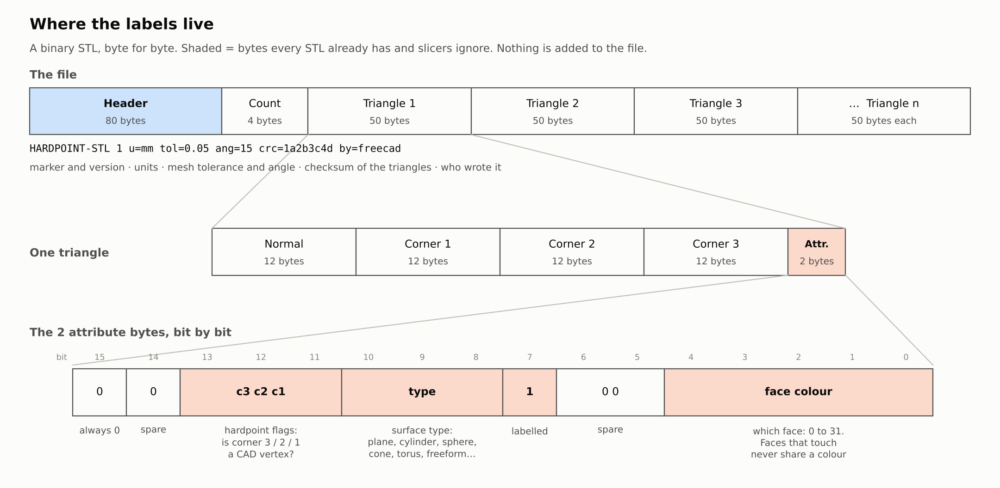

# Hardpoint STL (format version 1)

**WORK IN PROGRESS: MANY FEATURES MAY BE BROKEN** (hardpoint-stl 0.1.0-wip)

A hardpoint STL is an ordinary binary STL that also says which CAD face every triangle came
from, what kind of surface that face is, and where the CAD corners ("hardpoints") are. A
slicer reads it like any other STL. A mesh-to-CAD converter that knows the format can
rebuild the solid without guessing where the faces are.

Reference reader and writer: [`src/hstl.py`](src/hstl.py) (Python standard library only).
Design notes (why it is built this way, measurements, open questions): [DESIGN_NOTES.md](DESIGN_NOTES.md).
Example files: [`examples/`](examples/).

## What a slicer sees

Nothing is added to the file. It has the size of a plain binary STL with the same triangle
count, the extension stays `.stl`, and the triangle data (normals and corners) is exactly
what a normal export would write. The labels live in bytes every binary STL already has and
slicers ignore:

- the 80-byte header at the start of the file, and
- the 2-byte "attribute" field that follows every triangle.

Extra data after the last triangle was ruled out: the loader Cura uses (numpy-stl) and
trimesh both refuse such a file, and the STL reader shared by PrusaSlicer-family slicers
takes the triangle count from the file size.

## Header (80 bytes)

ASCII text, padded with spaces:

    HARDPOINT-STL 1 u=mm tol=0.05 ang=15 crc=1a2b3c4d by=freecad

| Field | Meaning |
|---|---|
| `HARDPOINT-STL 1` | marker and format version |
| `u` | units of the coordinates: `mm`, `in`, `cm` or `m` |
| `tol` | how far the triangles may be from the true surface, in those units (0 = unknown) |
| `ang` | meshing / sharp-edge angle in degrees (0 = unknown) |
| `crc` | CRC-32 of the triangle data: the 48 bytes of normal and corners of every triangle, in file order, attribute fields left out |
| `by` | what wrote the file (letters, digits, `-`, `_`, `.`) |

If `crc` doesn't match, the mesh was changed after it was labelled and the labels must be
ignored. A program that re-saves the STL normally writes its own header, which also turns
the file back into a plain STL.

## Attribute field (16 bits per triangle, little-endian)

| Bits | Meaning |
|---|---|
| 0–4 | **Face colour**, 0–31. A face is a set of triangles joined edge to edge that share a colour. Two faces that touch along an edge never share a colour, so a few colours label any number of faces, the way four colours do a map. |
| 5–6 | reserved, 0 |
| 7 | 1 = this triangle is labelled |
| 8–10 | **Surface type**: 0 unknown, 1 plane, 2 cylinder, 3 sphere, 4 cone, 5 torus, 6 freeform, 7 keep as facets |
| 11–13 | **Hardpoints**: bit 11 = corner 1 of this triangle is a CAD vertex, bit 12 = corner 2, bit 13 = corner 3 |
| 14 | reserved, 0 |
| 15 | always 0 |

Bit 7 has a second job. Slicers built on the admesh reader decide "binary or text STL?" by
looking for a byte above 127 near the start of the triangle data, and a simple part at
whole-millimetre coordinates can have none (OrcaSlicer issue 15993). With bit 7 set in the
first triangle's attribute field the file is always recognised as binary. The writer puts a
labelled triangle first for this reason.

Bit 15 stays 0 because some viewers read "bit 15 = 1" as "this field is a colour".

## Reading

1. The header must start with `HARDPOINT-STL` and the version must be one you know.
2. The file size must be 84 + 50 × triangle count, and the `crc` must match. Otherwise treat
   the file as a plain STL.
3. Weld triangle corners that have identical coordinates. Group triangles that share an edge
   and have the same face colour: each group is one CAD face. A triangle with bit 7 clear
   belongs to no face.
4. A face's surface type is the type most of its triangles carry.
5. Hardpoints are the corners flagged in bits 11–13.

Treat the labels as hints. STL2STEP, the converter this was developed with, checks every labelled face against its tolerance and
runs its normal detection on any face that doesn't fit what its label says.

## Writing

Triangles are written as usual (corners with identical coordinates where triangles meet, so
the mesh stays watertight). Faces are coloured so that neighbours differ. A labelled triangle
goes first.

## What has and hasn't been tested

Tested (Linux, simulated CAD parts built with OpenCASCADE):

- numpy-stl (Cura's loader) returns triangles identical to the same mesh written as a plain STL.
- trimesh loads the files as watertight meshes.
- The admesh binary/text test (as written in OrcaSlicer's source) classes the files as binary.
- The reference reader rebuilds exactly the faces, types and hardpoints that were written.
- A file with one changed byte of triangle data is refused; a plain STL is not mistaken for a labelled one.

Not tested: opening the files in a real slicer (PrusaSlicer, OrcaSlicer, Bambu Studio, Cura's
full program). Viewers that show per-triangle STL colours (VisCAM, SolidView, Materialise
Magics, MeshLab) may show the labels as colours or ignore them.
